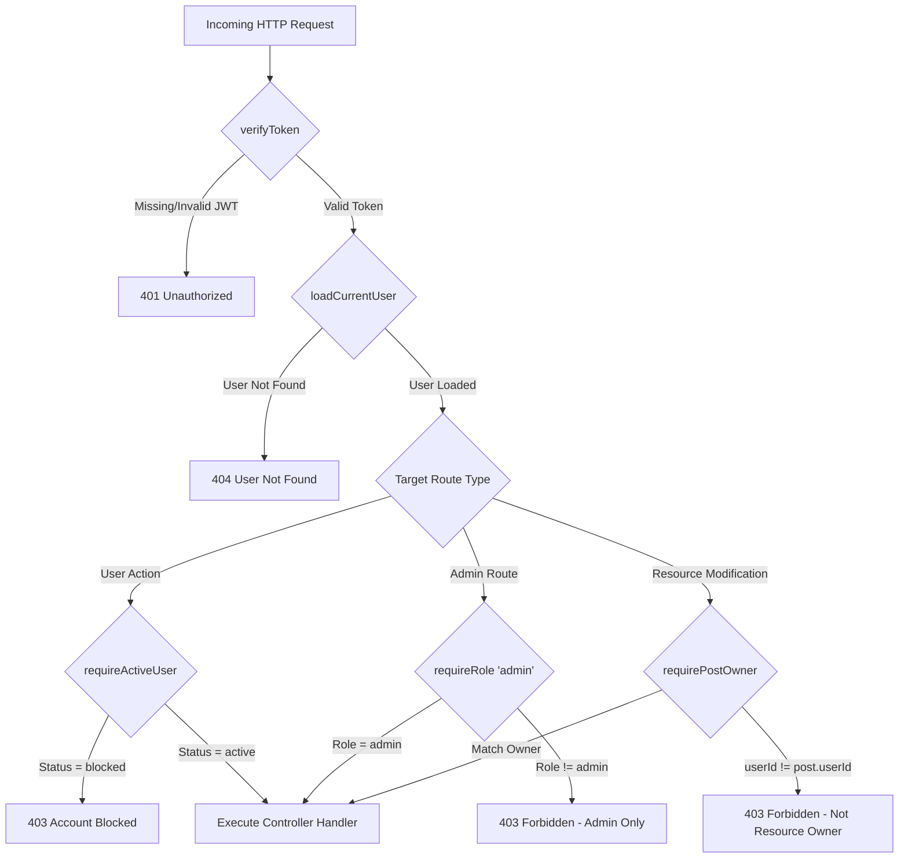

# 02 — Roles and Permissions Specification

> **Scope:** This document provides a detailed specification of the security model, Role-Based Access Control (RBAC) matrix, and Express middleware chain implemented in the **Tro Xin** platform. It details how user identity, authorization boundaries, status checks, and resource ownership are enforced across the application.

---

## 1. Security & Authorization Architecture

The system utilizes a **stateless JSON Web Token (JWT)** authentication mechanism combined with a layered Express middleware design.

- **Token Payload:** Upon successful authentication, the server issues a JWT containing the user's unique identifier (`id`) and administrative role (`role`).

- **Token Transport:** The client stores the token in web storage (`localStorage` or `sessionStorage`) and transmits it via the standard `Authorization: Bearer <token>` HTTP header.

- **Layered Defense:** Request verification operates through composable middleware functions, ensuring that access rights, account statuses, and resource ownership are sequentially verified before reaching controller handlers.

---

## 2. User Roles & Identity Definitions

The system defines three primary actor levels:

| Role      | System Identity               | Description & Scope                                                                                                      |
| --------- | ----------------------------- | ------------------------------------------------------------------------------------------------------------------------ |
| **Guest** | Unauthenticated (`Anonymous`) | Public users browsing the platform. Granted read-only access to published listings, location data, and category lookups. |

|
| **User** | `role = 'user'` | Authenticated standard accounts (Tenants / Landlords). Permitted to publish rental listings, edit owned content, bookmark posts, and manage personal profile details.

|
| **Admin** | `role = 'admin'` | Authenticated system administrators. Possesses global oversight for content moderation, post status enforcement, and user account blocking/unblocking.

|

---

## 3. Account Status States

In addition to roles, user authorization is governed by the `status` attribute in the `Users` model:

- **`active`**: Default state upon registration. Full operational rights according to the assigned role.

- **`blocked`**: Applied when an account is banned by an Administrator. Blocked users are prohibited from executing mutation requests (creating/updating/deleting posts or updating profiles).

---

## 4. Role-Based Access Control (RBAC) Matrix

The following matrix maps domain operations to authorization requirements across system actors:

| Domain Area            | Operation / Action                  | Endpoint / Scope                        | Guest | User (`active`) | User (`blocked`) | Admin |
| ---------------------- | ----------------------------------- | --------------------------------------- | ----- | --------------- | ---------------- | ----- |
| **Public / Discovery** | Browse public posts                 | `GET /api/v1/post/all`                  | ✅    | ✅              | ✅               | ✅    |
|                        | View post details                   | `GET /api/v1/post/:id`                  | ✅    | ✅              | ✅               | ✅    |
|                        | Fetch Categories & Locations        | `GET /api/v1/category/*`, `locations/*` | ✅    | ✅              | ✅               | ✅    |
| **Authentication**     | Register / Login                    | `POST /api/v1/auth/*`                   | ✅    | ❌              | ❌               | ❌    |
|                        | Fetch current identity              | `GET /api/v1/user/me`                   | ❌    | ✅              | ✅               | ✅    |
| **Profile & Account**  | Update profile info / password      | `PUT /api/v1/user/me`                   | ❌    | ✅              | ❌               | ✅    |
| **Post Lifecycle**     | Upload post images                  | `POST /api/v1/user/posts/upload-image`  | ❌    | ✅              | ❌               | ✅    |
|                        | Create new post                     | `POST /api/v1/user/posts`               | ❌    | ✅              | ❌               | ✅    |
|                        | Edit owned post                     | `PUT /api/v1/user/posts/:id`            | ❌    | ✅ (Owner)      | ❌               | ✅    |
|                        | Delete owned post                   | `DELETE /api/v1/user/posts/:id`         | ❌    | ✅ (Owner)      | ❌               | ✅    |
| **Saved Listings**     | Toggle save post                    | `POST /api/v1/user/saved-posts/:postId` | ❌    | ✅              | ❌               | ✅    |
|                        | View saved posts                    | `GET /api/v1/user/saved-posts`          | ❌    | ✅              | ✅               | ✅    |
| **Admin Moderation**   | Update post status (Approve/Reject) | `PATCH /api/v1/admin/posts/:id/status`  | ❌    | ❌              | ❌               | ✅    |
|                        | Block / Unblock user account        | `PATCH /api/v1/admin/users/:id/status`  | ❌    | ❌              | ❌               | ✅    |
|                        | Permanent post purge                | `DELETE /api/v1/admin/posts/:id/purge`  | ❌    | ❌              | ❌               | ✅    |

_Legend: ✅ Allowed | ❌ Denied / Forbidden_

---

## 5. Express Middleware Execution Pipeline

The server enforces authorization boundaries using a sequential middleware chain located in `server/src/middlewares/`:

### 5.1. Core Middleware Components

1. **`verifyToken`**: Extracts the Bearer token from the `Authorization` header, verifies its cryptographic signature using `SECRET_KEY`, and attaches decoded user claims (`id`, `role`) to `req.user`.

2. **`loadCurrentUser`**: Fetches the full user record from the database using `req.user.id` and populates `req.currentUser`.

3. **`requireActiveUser`**: Validates that `req.currentUser.status === 'active'`. Blocks requests with a `403 Forbidden` response if the account has been suspended.

4. **`requireRole(requiredRole)`**: Compares `req.user.role` against authorized roles (e.g., `'admin'`), rejecting unauthorized access attempts.

5. **`requirePostOwner`**: Fetches the target post and verifies that `post.userId === req.user.id` (bypassed if the user is an `admin`), preventing Horizontal Privilege Escalation.

---

## 6. Security Considerations & Protections

- **Horizontal Privilege Escalation Protection:** Users cannot modify or delete posts belonging to other landlords due to the `requirePostOwner` ownership verification step.

- **Account Banning Enforcement:** Suspended users with valid, unexpired JWT tokens are immediately blocked from state-modifying endpoints via `requireActiveUser`.

- **Password Isolation:** User queries and authentication handlers explicitly omit the `password` hash from API responses, preventing credential leakage in client payloads.
