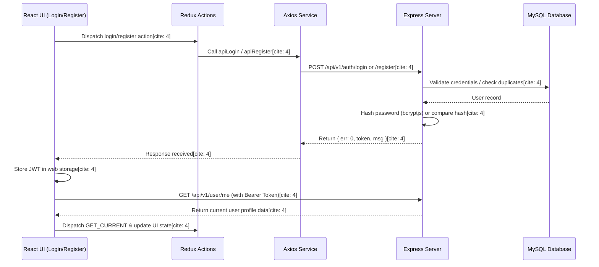
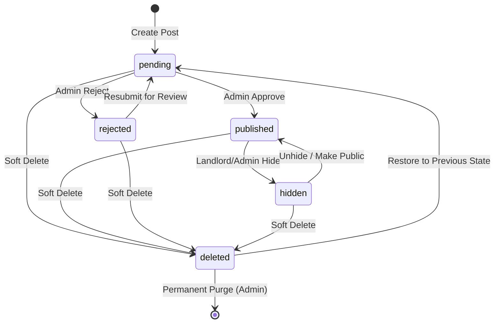

# 03 — End-to-End Workflows & Business Logic

> **Scope:** This document defines the end-to-end (E2E) data flow, operational state machines, and transactional business logic across the client, server, and database layers for the **Tro Xin** platform. It outlines how user actions translate into API calls, service transactions, and database state transitions.

---

## 1. Communication Protocol & Architecture Overview

- **Standard Server Response Format:** JSON objects typically containing `err` (`0` for success, non-zero for failure), `msg` (descriptive message), `response` (payload data), and `token` (where applicable).

- **Authentication Standard:** Stateless authentication via JSON Web Tokens (JWT) signed with `process.env.SECRET_KEY`.

- **Client Token Storage:** Tokens are persisted in `localStorage` (if remember-me is enabled) or `sessionStorage`, with storage mode tracked via `APP_TOKEN_STORAGE`.

- **Axios Interceptor:** Automatically reads the token from storage and injects the `Authorization: Bearer <token>` header into outgoing HTTP requests.

---

## 2. Core End-to-End Workflows

### 2.1. Authentication Workflow (Login / Register)

1. **User Input & Action Dispatch:** The user submits credentials via the login or registration interface, triggering Redux action creators.

2. **Server Validation & Hashing:** The backend controller validates input fields, verifies uniqueness (phone/email), and securely hashes or compares passwords using `bcryptjs`.

3. **Token Issuance & Persistence:** Upon successful validation, the server issues a JWT containing user identity and role claims. The frontend captures the token, persists it in web storage, and immediately fetches the current user profile via `/api/v1/user/me`.

---

### 2.2. Listing Creation Workflow (Image Upload & Transactional Write)

1. **Image Asset Handling:**

- _Cloudinary Integration:_ If configured (`REACT_APP_CLOUD_NAME`), client uploads images directly to Cloudinary and receives secure URLs.

- _Local Storage Fallback:_ If unconfigured, images are sent via `multipart/form-data` to `/api/v1/user/posts/upload-image`, where `multer` stores files locally under `uploads/posts/`.

2. **Form Submission & Normalization:** The client submits listing metadata (title, category, price, area, description, images) to `POST /api/v1/user/posts`.

3. **Sequelize Transaction Execution:**

- Initiates a database transaction to ensure atomicity.

- Generates four independent UUIDs for the main post, attributes, images, and overview records.

- Normalizes numerical price and area (`priceNumber`, `areaNumber`) alongside category and province codes.

- Creates the `Post` record with an initial status of `pending`, alongside associated extension records (`Attributes`, `Images`, `Overviews`).

- Commits the transaction and returns success to the client.

---

### 2.3. Administrative Moderation Workflow

1. **Moderation Trigger:** Administrators review listings in the `pending` state via the admin dashboard.

2. **Status Transition Rules:** Status changes are strictly governed by transition utility functions (`canTransitionPostStatus`).

3. **Audit Trail Metadata:** When an admin approves, rejects, or updates a post status, the system records `moderatedAt` (timestamp), `moderatedBy` (admin ID), and `moderationReason` (audit notes).

4. **Soft Deletion & Restoration:** Moving a post to `deleted` preserves its prior operational state in `deletedFromStatus`, enabling controlled restoration back to its exact former state.

---

### 2.4. Saved Posts (Bookmark) Workflow

1. **Toggle Execution:** Authenticated users trigger bookmarking via `POST /api/v1/user/saved-posts/:postId`.

2. **Publish Status Validation:** The service strictly verifies that the target post has a `published` status; pending, hidden, rejected, or deleted posts cannot be bookmarked.

3. **Database Operation:** The service toggles the existence of the composite record in the `SavedPosts` table (utilizing a unique index on `userId` and `postId`) to insert or remove the bookmark atomically.

---

### 2.5. Profile Update & Password Change Workflow

1. **Endpoint Routing:** Profile edits (`PUT /api/v1/user/me`) support partial payloads for contact details (name, phone, zalo, email) as well as secure credential updates (`currentPassword`, `newPassword`).

2. **Password Verification:** If a new password is provided, the system verifies the existing password using `bcrypt.compareSync`, hashes the new password with bcrypt, and updates the record.

3. **Token Refresh Synchronization:** Upon successful profile or credential updates, the server issues a refreshed JWT token containing updated claims, which the client overwrites in storage to maintain active session integrity.

---

## 3. Middleware Security Pipeline Summary

Every incoming request passes through a strict, sequential middleware chain depending on the endpoint category:

- **Public Read Endpoints:** Open access without token requirements (e.g., browsing public post lists).

- **Protected User Writes:** Requires `verifyToken` $\rightarrow$ `loadCurrentUser` $\rightarrow$ `requireActiveUser` (ensuring account is not blocked).

- **Resource Ownership Guard:** Requires `loadPost` $\rightarrow$ `requirePostOwner` to prevent horizontal privilege escalation when editing or deleting posts.

- **Admin-Only Routes:** Requires `verifyToken` $\rightarrow$ `loadCurrentUser` $\rightarrow$ `requireRole('admin')`.

---

## 4. Transaction Consistency & Error Handling

- **Atomicity:** Complex write operations (such as post creation, updating, and cascading deletion) utilize Sequelize transactions to prevent orphan records across the `Posts`, `Attributes`, `Images`, and `Overviews` tables.

- **File Cleanup:** Permanent deletion flows execute cleanups of physical local asset files (`removeLocalPostAssets`) subsequent to successful database transaction commits.
