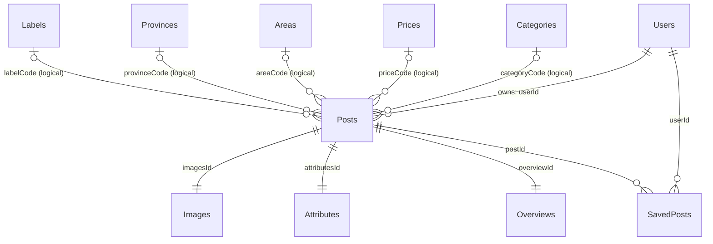
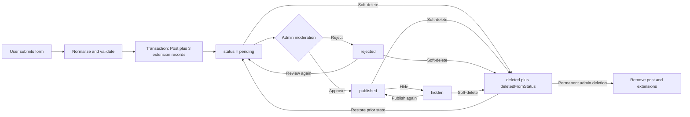

# 04 — Data Model

> Scope: this document describes the data schema that is currently implemented in the source code of the rental-listing platform. It records the actual implementation, not a proposed redesign. Where a relationship is only enforced by application code, that is stated explicitly.

## 1. Overview

The application uses **MySQL** through the **Sequelize** ORM. The core entity is `Posts`, a rental listing. A listing has one owner, three associated detail records, a publication/moderation state, and may be saved by many users.

`Categories`, `Prices`, `Areas`, `Provinces`, and `Labels` are lookup tables. Listings store matching `*Code` values rather than database foreign keys, so these are logical application relationships.

Solid relations are declared by Sequelize. Relations marked *logical* are code matching only; MySQL does not enforce them through a foreign key.

### 1.1 Core entity and data-model boundary

`Posts` is the project’s **central aggregate**. Searchers find and read a post; owners create and manage it; administrators moderate it; and the saved-listing feature references it. Reading the ERD should therefore begin with four questions:

| Business question | Data answering it | Main entities/fields |
| --- | --- | --- |
| Who is responsible for this listing? | Owner identity, contact data, and access rights. | `Posts.userId` → `Users.id` |
| Is it allowed to appear publicly? | Current status and latest moderation context. | `Posts.status`, `moderated*`, `deletedFromStatus` |
| What is offered, where, and at what price? | Content, location, category, province, price, and area. | `Posts` and lookup tables |
| How is it rendered to viewers? | Images, display values, listing code, tenant target, and validity period. | `Images`, `Attributes`, `Overviews` |

The current model has no standalone entities for a physical property, room inventory, contract, payment, chat, or versioned moderation history. A `Post` is both the rental-advertisement unit and the moderation/visibility unit. `Overviews` is not a shared property table: it is supplementary data for one post.

### 1.2 ERD design approach

The implementation combines three patterns:

1. **Independent entities:** `Users`, `Posts`, and `SavedPosts` have clear business lifecycles and are shared across features.
2. **One-to-one extension tables:** `Images`, `Attributes`, and `Overviews` exist for one listing and are written or removed with that listing by the service layer.
3. **Code-based lookup tables:** `Categories`, `Prices`, `Areas`, `Provinces`, and `Labels` remove repeated lookup values and supply filter options, while `Posts` retains their codes.

Separating images, attributes, and overview data matches the original UI/import shape, where header details, images, and overview content are distinct blocks. The trade-off is that a complete post read joins `Posts` with three extension tables. The post service encapsulates these joins through Sequelize `include` definitions.

## 2. Table groups

| Group | Tables | Responsibility |
| --- | --- | --- |
| Accounts | `Users` | Identity, authentication, role, block status, and contact channels. |
| Core business | `Posts` | Rental listing, ownership, search data, and moderation state. |
| Listing details | `Images`, `Attributes`, `Overviews` | Image list, display-oriented values, and detail-page overview data. |
| Favorites | `SavedPosts` | Many-to-many relation between users and saved listings. |
| Lookups | `Categories`, `Prices`, `Areas`, `Provinces`, `Labels` | Category and filtering option data. |

All tables include Sequelize-managed `createdAt` and `updatedAt` timestamps unless noted otherwise.

## 3. Entity relationships and cardinality

| Relationship | Business cardinality | Join fields | How it is maintained | Deletion impact |
| --- | --- | --- | --- | --- |
| `Users` — `Posts` | One user owns 0..n posts; each post has one owner. | `Posts.userId` → `Users.id` | `User.hasMany(Post)` and `Post.belongsTo(User)` in Sequelize; no physical FK. | No database cascade; there is no user-deletion workflow. |
| `Posts` — `Images` | One post has one image collection. | `Posts.imagesId` → `Images.id` | `Post.belongsTo(Image)` and post-service transactions. | Post deletion removes the image record; permanent deletion also removes local files. |
| `Posts` — `Attributes` | One post has one display-attribute record. | `Posts.attributesId` → `Attributes.id` | `Post.belongsTo(Attribute)` and transactions. | Post deletion removes the attribute record. |
| `Posts` — `Overviews` | One post has one overview record. | `Posts.overviewId` → `Overviews.id` | `Post.belongsTo(Overview)` and transactions. | Post deletion removes the overview record. |
| `Users` — `Posts` via `SavedPosts` | A user may save 0..n posts; a post may be saved by 0..n users. | `SavedPosts.userId`, `SavedPosts.postId` | A composite unique index prevents duplicate saves. | No cascade; saved rows can become orphaned. |
| Lookup table — `Posts` | One lookup value may classify many posts. | Relevant `*Code` | Code matching in create/update/filter logic. | No FK or cascade. |

### 3.1 Relationship layers

**ORM relationships** allow Sequelize to generate joins when reading a post. A `Post` can load its `user`, `images`, `attributes`, and `overview`. They do not create MySQL foreign keys because migrations do not declare `references`.

**Lookup-code relationships** are not Sequelize associations. Filters query `Posts.priceNumber`, `Posts.areaNumber`, `Posts.provinceCode`, and/or `address` directly. Lookup tables supply UI option sets, so a lookup change does not automatically modify historic posts.

### 3.2 Keys and identifiers

| Identifier type | Used by | Generation | Purpose |
| --- | --- | --- | --- |
| String UUID | `Users`, `Posts`, `Images`, `Attributes`, `Overviews` | Application `uuid.v4()` | Can be generated before insert and connect four records in one transaction. |
| Auto-increment integer | Lookup tables and `SavedPosts` | MySQL | Technical primary key; not the cross-table business identifier. |
| Business `code` | Lookups and `Posts.*Code` | Seed, import, and utility code | Stable value for filtering/display, but no enforced uniqueness or referential integrity. |
| Display code | `Attributes.hashtag`, `Overviews.code` | Generated on post creation | Presentation data, neither primary key nor uniqueness-constrained. |

## 4. Table details

### 4.1 `Users` — accounts and authorization

`id` is a string UUID. JWTs contain the user ID and role. `password` is bcrypt-hashed and excluded from user-facing responses.

| Column | Type | Meaning and rule |
| --- | --- | --- |
| `id` | `STRING`, PK | Application-generated UUID. |
| `name`, `phone` | `STRING` | Person name and phone. Services validate phone format, but there is no unique phone index in the migration. |
| `email` | `STRING`, unique, nullable | Login email, normalized to lowercase. Legacy records may use `fbUrl` as an email field. |
| `password` | `STRING` | bcrypt hash; never plaintext. |
| `role` | `STRING`, default `user` | `user` or `admin`. |
| `status` | `STRING`, default `active` | `active` or `blocked`. |
| `blockedAt`, `blockedReason` | `DATE`, `STRING`, nullable | Context recorded when an administrator blocks an account. |
| `zalo`, `fbUrl` | `STRING` | Contact channels; `fbUrl` is retained for legacy compatibility. |
| `avatar` | `BLOB(long)` | Binary avatar image. |

Additional indexes: `users_email_unique` (`email`, unique) and `users_status_role_idx` (`status`, `role`).

### 4.2 `Posts` — listing data center

`id` is a UUID. A post is created together with `Images`, `Attributes`, and `Overviews` in one transaction. Price and area are stored both numerically for filtering and as display strings for presentation.

| Column | Type | Meaning and rule |
| --- | --- | --- |
| `id` | `STRING`, PK | Listing UUID. |
| `title`, `address` | `STRING` | Rental-listing title and address. |
| `description` | `TEXT` | Content normalized from an array/string and stored as a JSON string. |
| `star` | `STRING`, default `0` | Display star level; no active business update flow was found. |
| `userId` | `STRING` | Owner, logically referencing `Users.id`. |
| `imagesId`, `attributesId`, `overviewId` | `STRING` | IDs for the three extension records. |
| `categoryCode`, `labelCode` | `STRING` | Category and label/import classification. |
| `priceCode`, `areaCode`, `provinceCode` | `STRING` | Price-range, area-range, and province filter codes. |
| `priceNumber`, `areaNumber` | `FLOAT` | Normalized monthly price (million VND) and area (m²) for numeric filtering. |
| `status` | `STRING`, not null | `pending`, `published`, `rejected`, `hidden`, or `deleted`. New posts are `pending`. |
| `moderatedAt`, `moderatedBy`, `moderationReason` | `DATE`, `STRING`, `TEXT` | Latest moderation context; `moderatedBy` has no FK. |
| `deletedFromStatus` | `STRING`, nullable | Status before admin soft deletion; used for controlled restoration. |

Indexes: `posts_status_created_at_idx` (`status`, `createdAt`) supports public lists; `posts_user_status_created_at_idx` (`userId`, `status`, `createdAt`) supports owner management.

| Data group | Fields | Reason |
| --- | --- | --- |
| Source content | `title`, `address`, `description` | Owner-entered content seen by rental seekers. |
| Search/classification | `categoryCode`, `priceCode`, `areaCode`, `provinceCode`, `priceNumber`, `areaNumber` | Efficient grouping and filtering. |
| Ownership/components | `userId`, `imagesId`, `attributesId`, `overviewId` | Connects the listing to its owner and extensions. |
| Lifecycle | `status`, `moderatedAt`, `moderatedBy`, `moderationReason`, `deletedFromStatus` | Supports review and visibility without overwriting content. |
| Presentation/compatibility | `star`, `labelCode` | UI or imported legacy data; not authorization data. |

`priceNumber` and `areaNumber` are the source of truth for numeric comparisons. `priceCode` and `areaCode` are range labels; `Attributes.price` and `Attributes.acreage` are human-readable strings. This intentional presentation-level denormalization prevents repeated formatting on every read.

### 4.3 One-to-one post extensions

| Table | Key | Business fields | Usage |
| --- | --- | --- | --- |
| `Images` | `id: STRING` | `image: TEXT(long)` | JSON string containing an array of local or external image URLs; images are not separate rows. |
| `Attributes` | `id: STRING` | `price`, `acreage`, `published`, `hashtag` | Display price/area, Vietnamese-formatted publication date, and a listing hashtag. |
| `Overviews` | `id: STRING` | `code`, `area`, `type`, `target`, `bonus`, `created`, `expired` | Detail-page overview information; default expiry is 10 days after creation. |

`Posts.imagesId`, `Posts.attributesId`, and `Posts.overviewId` point to these primary keys. The post services create, update, and remove related records within transactions.

### 4.4 `SavedPosts` — saved listings

This junction table represents the many-to-many saved-listing relation.

| Column | Type | Meaning |
| --- | --- | --- |
| `id` | `INTEGER`, PK, auto increment | Technical row ID. |
| `userId` | `STRING`, not null | User saving the post. |
| `postId` | `STRING`, not null | Saved post. |
| `createdAt`, `updatedAt` | `DATE`, not null | Save/update timestamps. |

`saved_posts_user_post_unique` ensures a user saves a post only once. `saved_posts_user_created_at_idx` supports ordering by recent saves. The API returns only saved posts whose status is `published`.

> This table is created by startup code when missing (`server/server.js`); it currently has no dedicated migration.

### 4.5 Lookup tables

| Table | PK | Data | Role |
| --- | --- | --- | --- |
| `Categories` | `id: INTEGER` | `code`, `value`, `header`, `subheader` | Rental categories and headings. |
| `Prices` | `id: INTEGER` | `code`, `value`, `order` | Filter price ranges; seeded when empty. |
| `Areas` | `id: INTEGER` | `code`, `value`, `order` | Filter area ranges; seeded when empty. |
| `Provinces` | `id: INTEGER` | `code`, `value` | Province/city catalog; default data is seeded when empty. |
| `Labels` | `id: INTEGER` | `code`, `value` | Labels retained for imported legacy data. |

None currently has a unique index on `code`; input and management processes must avoid duplicate codes.

## 5. Data lifecycle and flows

### 5.1 Listing lifecycle

This diagram reflects service-level transitions. Rules are defined in `accessControl.js`; invalid transitions are rejected. A `deleted` post cannot freely become `published`: it must be restored to the exact status stored in `deletedFromStatus`.

### 5.1.1 Listing creation and update

1. The owner submits title, category, price, area, address, province, description, and images. Validation requires category, a 10-character title, address, province, at least one image, positive price/area, and a 20-character description.
2. The server normalizes numbers, images, and description, then derives `priceCode`, `areaCode`, `provinceCode`, and the province name.
3. Creation generates UUIDs for post, attributes, images, and overview. A transaction writes all four tables, preventing a partially-created listing.
4. `Posts` stores ownership and filter data; `Attributes` stores formatted display data; `Images` stores the JSON image list; `Overviews` stores type, tenant target, package, and expiration.
5. New posts are always `pending`. Only `published` posts are public or returned in saved-list results. Content editing does not automatically alter status.

For updates, the service queries by both `postId` and `userId`, so an owner can modify only their own post. It updates `Posts` and upserts missing extension records to support incomplete legacy/import data.

### 5.1.2 Moderation and deletion

When an administrator changes `Posts.status`, the system updates `moderatedAt`, `moderatedBy`, and `moderationReason`. Soft deletion stores the earlier state in `deletedFromStatus`. Permanent deletion is allowed only for a `deleted` post and removes the three extension records and local image assets.

The owner’s deletion path differs: current code directly deletes `Posts` and its extensions instead of using the `deleted` status.

### 5.2 Read flows and response shape

| Read need | Post condition | Additional data | Purpose |
| --- | --- | --- | --- |
| Public list/search | `status = published`; optional category, price, area, province, keyword filters. | `Images`, `Attributes`, `Users` | Listing cards and safe contact data. |
| Post detail | Visibility checked against status and viewer context. | `Images`, `Attributes`, `Overviews`, `Users` | Full listing content and metadata. |
| Owner management | Current `userId`, optionally a status. | All associations | Shows pending/rejected/hidden/deleted posts and reasons. |
| Admin management | Status, user, and province filters. | All associations | Moderation, restoration, and permanent deletion. |
| Saved posts | `SavedPosts.userId` plus `Posts.status = published`. | `Posts`, then image/attribute/user | Shows only listings still public. |

The server parses the stored image JSON into a URL array and normalizes the description before returning it. Database shape and frontend response shape are therefore not identical.

### 5.3 Saved-listing flow

1. An authenticated user toggles a `postId`.
2. Only a currently `published` post can be saved.
3. If (`userId`, `postId`) already exists, the row is deleted; otherwise it is created.
4. The composite unique index is the final protection against duplicate concurrent favorites.

Saving does not modify `Posts`, increment a view count, or write activity history; it stores only the user’s current favorite state.

## 6. Persisted states

| Object | Value | Meaning |
| --- | --- | --- |
| `Users.status` | `active` / `blocked` | Account is active or blocked; blocked users cannot sign in. |
| `Users.role` | `user` / `admin` | Regular user or administrator. |
| `Posts.status` | `pending` | Waiting for review. |
|  | `published` | Publicly visible. |
|  | `rejected` | Rejected; may return to `pending`. |
|  | `hidden` | Hidden; may be published again. |
|  | `deleted` | Soft-deleted through the admin flow; restored through `deletedFromStatus`. |

### 6.1 Post status-transition matrix

| Current state | Allowed target state | Interpretation |
| --- | --- | --- |
| `pending` | `published`, `rejected`, `deleted` | Approve, reject, or remove a new submission. |
| `published` | `hidden`, `deleted` | Hide or soft-delete a public post. |
| `rejected` | `pending`, `deleted` | Send back for review or soft-delete. |
| `hidden` | `published`, `deleted` | Re-publish or soft-delete. |
| `deleted` | Only `deletedFromStatus` | Controlled restoration, not a free transition. |

Each admin state change stores the latest moderator, timestamp, and reason. This is not a full audit log: earlier transitions are overwritten rather than retained in a history table.

## 7. Actual constraints and technical considerations

1. **No physical foreign keys.** Migrations create ID/code columns without `references`. Sequelize supports joins, but MySQL does not prevent orphan records.
2. **One-to-one is a convention.** `Posts` points to one `Image`, `Attribute`, and `Overview`, but reverse unique constraints and unique post ID columns are absent.
3. **Post deletion does not proactively remove `SavedPosts`.** Without an FK cascade, permanent deletion can leave orphan saved rows.
4. **Display data is intentionally duplicated.** `priceNumber`/`areaNumber` are for filtering, while `Attributes.price`/`acreage` are for display. Updates should use the service layer to keep them consistent.
5. **Lookup codes are application-managed.** The DB does not verify that `categoryCode`, `priceCode`, `areaCode`, `provinceCode`, or `labelCode` exists. Renaming/deleting a code can make older posts inconsistent with lookup results.
6. **Legacy compatibility remains.** Legacy `draft` is normalized to `pending`; `fbUrl` can be interpreted as an email for older data.
7. **Moderation history is overwritten.** A separate event/history table is required for a complete compliance audit trail.

## 8. Source references

- Models and associations: `server/src/models/`.
- Table/index creation: `server/src/migrations/` and startup compatibility code in `server/server.js`.
- State rules: `server/src/ultis/accessControl.js`.
- Listing read/write/delete transactions: `server/src/services/post.js`.
- Saved-listing operations: `server/src/services/savedPost.js`.
